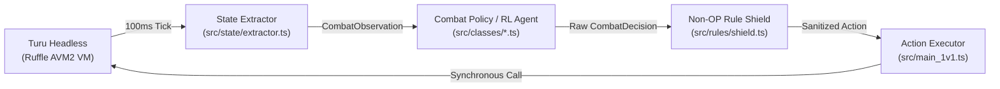
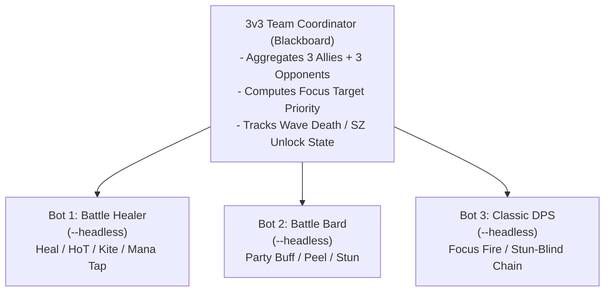

# System Architecture

## 1. Overview

The **AQW Classic (Non-OP) PvP AI** is designed around a **Rule-Shielded Decision Pipeline**. Whether driven by a deterministic heuristic controller (Phase 1–2) or a trained Multi-Agent Reinforcement Learning policy (MAPPO in Phase 4–5), every raw decision must pass through a deterministic **Non-OP Rule Shield** before reaching Turu's AVM2 bridge.

---

## 2. Core Components

### 2.1 State Extractor (`src/state/extractor.ts`)
At every `100ms` tick, the extractor queries Turu's synchronous Rust-to-AVM2 bridge:
- **Self State:** Health ratio, Mana ratio, `(x, y)` coordinates, cell/pad, active combat status, skill readiness (`canUseSkill(1..4)`), and `bot.self.snapshots` (all active self buffs/debuffs with remaining durations and stack counts).
- **Room & Opponent State:** Iterates `bot.map.playerNames` and `bot.map.getPlayer(name)` (`world.uoTree`) along with `bot.self.getPlayerAura(name)` to build a full `PlayerSnapshot` for every ally and opponent in the room.
- **NPC State:** Reads `bot.monsters.currentMonsters` in the current `/bludrutbrawl` cell so the agent knows the exact HP of nearby *Brawlers* and *Restorers*.

### 2.2 Non-OP Rule Shield (`src/rules/preflight.ts` & `src/rules/shield.ts`)
Tournament rules are enforced as **hard mathematical constraints (Action Masks)** rather than soft reward penalties:
1. **Pre-Flight Check (`runNonOpPreflightCheck`):** Runs prior to match start. Verifies that the player's equipped class is legal for the match format (`1v1` vs `3v3`), checks that `enhancementPatternId` on all equipped items is standard (`1..9`, blocking Awe/Forge `23..32`), confirms a `+5000` or `+5500` PvP Amulet is equipped, and sets `bot.options.infiniteRange = false`.
2. **NPC Protection Guard (`enforceNpcProtectionGuard`):** Continuously monitors `bot.player.target`. If the bot is mana-tapping a protected NPC (`Brawler`, `Restorer`, `Captain`) and the NPC's HP drops below `2000 HP` or `35%`, it immediately invokes `cancelAutoAttack()` and `cancelTarget()`, and blocks offensive skills (`USE_SKILL_1..4`) against NPCs.
3. **Safezone Wave Lock (`applyRuleShield`):** Tracks wave engagements. Blocks `RETREAT_TO_SAFEZONE` while a wave is active unless the format's wave-reset condition has triggered (`1v1`: opponent killed; `2v2+`: any teammate or opponent died).

---

## 3. Scaling from 1v1 to 3v3 ("Centralized Brain, Decentralized Execution")

In `3v3` Non-OP format (**Battle Healer + Battle Bard + Classic DPS**), three `turu --headless` instances run concurrently on the same host sharing a state blackboard:

